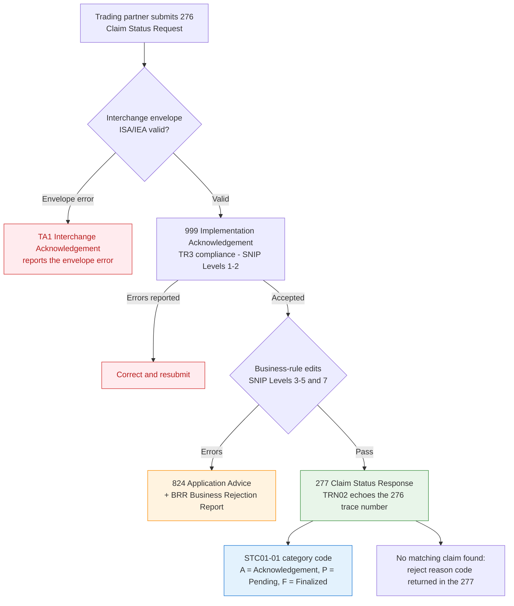

# DC Medicaid 276/277 FFS Claims – Enhanced Guide

> **Reformatted for clarity** from the official Gainwell *Companion Guide (CG) – DC Medicaid 276/277 FFS Claims*, Version 1.1 (Feb 5, 2025):
> [PDF in this repo](DC_276_277FFS-FFS-Claims-Companion-Guide-v1.1.pdf) · [public copy on gainwelltechnologies.com](https://www.gainwelltechnologies.com/wp-content/uploads/2025/07/DC_276_277FFS-FFS-Claims-Companion-Guide-v1.1.pdf)
>
> Dense tables → clean, scannable reference. Every value below is traceable to a page of the guide or to the code lists the guide defers to via the ASC X12N TR3s (§1.1, p. 1), which X12 publishes at x12.org (see [Sources](#sources)). Page numbers are the guide's printed page numbers (PDF page = printed page + 5).

---

## 1. 276 Request – envelope and key values (what you send)

Source: §7 *ISA and GS Segment Values for 276 Claim Status Inquiry* (pp. 9–10) and §8 *276 CG Transaction Table* (pp. 11–15).

| Loop | Element | Value / Code | Guide Notes/Comments (verbatim) | Page |
|------|---------|--------------|---------------------------------|------|
| Header | **ISA08** Interchange Receiver ID | `DCMEDICAID` | – | 9 |
| Header | **ISA13** Interchange Control Number | unique per file | Unique Control Number per file defined by sending Trading Partner | 9 |
| Header | **GS03** Application Receiver's Code | `DCMEDICAID` | – | 9 |
| Header | **GS08** Version / Release Code | `005010X212` | – | 9 |
| Header | **ST01** Transaction Set Identifier Code | `276` | Health Care Claim Status Request | 11 |
| Header | **ST03** TR3 Version Name | `005010X212` | – | 11 |
| Header | **BHT02** Transaction Set Purpose Code | `13` | Request | 11 |
| 2100A | **NM108 / NM109** Payer | `PI` / `DCMEDICAID` | Payer Identification / DCMEDICAID | 12 |
| 2100B | **NM108 / NM109** Information Receiver | `46` / Trading Partner ID | Electronic Transmitter Identification Number (ETIN) / DC Medicaid Trading Partner ID | 12 |
| 2100C | **NM108** Provider ID qualifier | `XX` or `SV` | XX – NPI; SV – DC Medicaid Provider ID | 13 |
| 2100D | **NM108 / NM109** Subscriber | `MI` / Member ID | Member Identification Number / DC Medicaid Member ID | 14 |
| 2200D | **TRN02** Current Transaction Trace Number | submitter-assigned | Submitter Trace Number – This number is echoed back on the 277. | 14 |
| 2200D | **REF01 / REF02** Payer Claim Control Number | `1K` / ICN | Payor's Claim Number / DC Medicaid ICN | 14–15 |
| 2200D | **AMT01** Amount Qualifier Code | `T3` | Total Submitted Charges (AMT segment note: Inquiry by Member, Dates of Service and Billed Amount) | 15 |
| 2200D | **DTP01 / DTP02** Claim Service Date | `472` / `RD8` | Service / Date Range | 15 |

The Notes/Comments column is copied from the guide's Notes/Comments column. Where a row covers two elements, the two cells are separated by " / "; "–" means the guide's cell is blank; a code prefix the guide repeats in that column (e.g. "13 – Request") appears once, in the Value / Code column.

**Payer rules worth knowing** (§5 *Payer Business Rules and Limitations*, p. 7)

- All members are primary subscribers; dependent-level segments are ignored and are not returned in the response.
- If no matching claim is found, "an appropriate reject reason code will be returned in the 277."
- If multiple matches are found within the requested date range, all are returned.
- Real-time requests are limited to a single claim status request per ISA-IEA, GS-GE and ST-SE envelope.
- Transactions are validated at SNIP Levels 1–5 and 7.

---

## 2. Acknowledgements and reports (what comes back)

Source: §6 *Acknowledgements and Reports* (p. 8) and Appendix A.5–A.8 (p. 23). The guide describes these four responses; it does **not** enumerate individual TA1 or 999 error codes – for those it refers trading partners to the CEF-Online user guides.

| Type | What it is | When it is generated | Page |
|------|------------|----------------------|------|
| **TA1** | Interchange Acknowledgement – verifies the syntactical accuracy of the interchange envelope and reports envelope-segment errors | If requested by setting ISA14 to `1`, or if ISA14 is `0` and there is an error that needs to be reported | 8, 23 |
| **999** | Implementation (Functional) Acknowledgement – reports errors found while checking compliance against the TR3, or acceptance of a transaction that meets the TR3 (SNIP Levels 1 and 2) | Reports errors or acceptance of the submitted transaction | 8, 23 |
| **824** | Application Reporting / Application Advice (005010X186) – results of data-content (business-rule) edits such as invalid diagnosis codes, procedure codes or provider numbers; does not replace the TA1 or 999 | Only if there are errors within the transaction for SNIP Levels 3–5 and 7 | 8, 23 |
| **BRR** | Business Rejection Report – a readable version of the 824 to help identify and resolve errors for resubmission | Produced with the 824 | 8, 23 |

---

## 3. 277 Response – claim status (STC segment)

Source: §9 *277 CG Transaction Table*, loop 2200D STC (pp. 19–21). The guide defines the **structure** of the status composite; the **code values** come from the code lists the guide defers to via the TR3 (§1.1, p. 1: "Refer to the ASC X12N Implementation Guides or 5010 Technical Report Type 3 (TR3s) for information not supplied in this document, such as code lists"), which X12 publishes at x12.org.

### 3.1 STC layout as defined in the guide

| Element | Name | Guide note | Page |
|---------|------|------------|------|
| **STC01-01** | Industry Code | Health Care Claim Status **Category** Code → §3.2 | 19, 21 |
| **STC01-02** | Industry Code | Health Care Claim Status Code ¹ | 19, 21 |
| **STC01-03** | Entity Identifier Code | Entity Code | 19 |
| **STC02** | Date | Status information effective date, CCYYMMDD | 19, 21 |
| **STC04** | Monetary Amount | Total Claim Charge Amount (claim level) / Charge Amount (line level) | 19, 21 |
| **STC05** | Monetary Amount | Total Provider Payment Amount (claim level) / Provider Payment Amount (line level) | 19, 21 |
| **STC10, STC11** | Health Care Claim Status | Additional status composites with the same `-01` / `-02` (/ `-03`) structure | 20–21 |

¹ The guide's Notes column prints "Category Code" for both STC01-01 and STC01-02. X12 maintains two separate external lists: [Claim Status Category Codes](https://x12.org/codes/claim-status-category-codes) (STC01-01) and [Claim Status Codes](https://x12.org/codes/claim-status-codes) (STC01-02).

STC03 does not appear in the guide's STC table and is not shown here.

### 3.2 Claim Status Category Codes (STC01-01)

Source: X12 *Claim Status Category Codes* external code list – <https://x12.org/codes/claim-status-category-codes> (accessed 2026-10-23); definitions quoted from that list (the family prefix, e.g. "Acknowledgement/", is carried by the section column), and the *X12 list section* column is the heading the list files each code under. The DC guide does not state which of these DC Medicaid returns. The full list (including the `R*`, `DR*`, `E*` families) is on x12.org.

| Code | X12 list section | X12 definition |
|------|------------------|----------------|
| **A0** | Acknowledgements | Forwarded – The claim/encounter has been forwarded to another entity. |
| **A1** | Acknowledgements | Receipt – The claim/encounter has been received. This does not mean that the claim has been accepted for adjudication. |
| **A2** | Acknowledgements | Acceptance into adjudication system – The claim/encounter has been accepted into the adjudication system. |
| **A3** | Acknowledgements | Returned as unprocessable claim – The claim/encounter has been rejected and has not been entered into the adjudication system. |
| **A4** | Acknowledgements | Not Found – The claim/encounter can not be found in the adjudication system. |
| **A6** | Acknowledgements | Rejected for Missing Information – The claim/encounter is missing the information specified in the Status details and has been rejected. |
| **A7** | Acknowledgements | Rejected for Invalid Information – The claim/encounter has invalid information as specified in the Status details and has been rejected. |
| **P1** | Pending | In Process – The claim or encounter is in the adjudication system. |
| **P2** | Pending | Payer Review – The claim/encounter is suspended and is pending review (e.g. medical review, repricing, Third Party Administrator processing). |
| **F0** | Finalized | The claim/encounter has completed the adjudication cycle and no more action will be taken. |
| **F1** | Finalized | Payment – The claim/line has been paid. |
| **F2** | Finalized | Denial – The claim/line has been denied. |
| **F4** | Finalized | Adjudication Complete – No payment forthcoming – The claim/encounter has been adjudicated and no further payment is forthcoming. |
| **E0** | Error | Response not possible - error on submitted request data |
| **D0** | Searches | Data Search Unsuccessful – The payer is unable to return status on the requested claim(s) based on the submitted search criteria. |

---

## 4. Acknowledgement and response flow

Built from §2.1 (p. 3), §5 (p. 7), §6 (p. 8) and §9 (pp. 19–21). Note that a TA1 is also returned, without an error, whenever the sender sets ISA14 = `1`.

---

## Sources

1. Gainwell Technologies, *Companion Guide (CG) – DC Medicaid 276/277 FFS Claims*, Version 1.1, February 5, 2025 (30 pages).
   - Copy in this repo: [DC_276_277FFS-FFS-Claims-Companion-Guide-v1.1.pdf](DC_276_277FFS-FFS-Claims-Companion-Guide-v1.1.pdf)
   - Public copy hosted by Gainwell: <https://www.gainwelltechnologies.com/wp-content/uploads/2025/07/DC_276_277FFS-FFS-Claims-Companion-Guide-v1.1.pdf> (SHA-256 of both copies: `56b4b772004f8c761f86dbc7658aa01138bb3e699f6dc94bc84de8b6433ee6ce`, verified 2026-10-23)
   - Sections cited: §1.1 Overview (p. 1); §2.1 Information for Existing Trading Partners (p. 3); §5 Payer Business Rules and Limitations (p. 7); §6 Acknowledgements and Reports (p. 8); §7 ISA and GS Segment Values (pp. 9–10); §8 276 CG Transaction Table (pp. 11–15); §9 277 CG Transaction Table (pp. 16–21); Appendix A.5–A.8 (p. 23).
2. X12, *Claim Status Category Codes* (external code list used in STC01-01): <https://x12.org/codes/claim-status-category-codes> – accessed 2026-10-23.
3. X12, *Claim Status Codes* (external code list used in STC01-02): <https://x12.org/codes/claim-status-codes> – accessed 2026-10-23.
