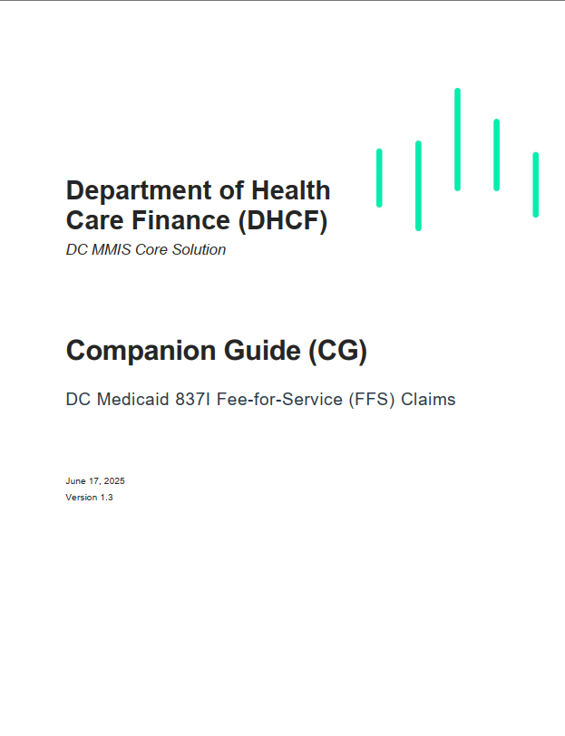
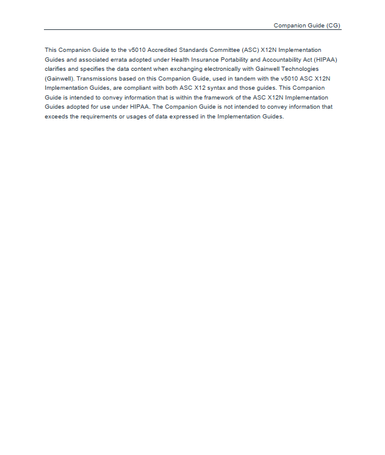
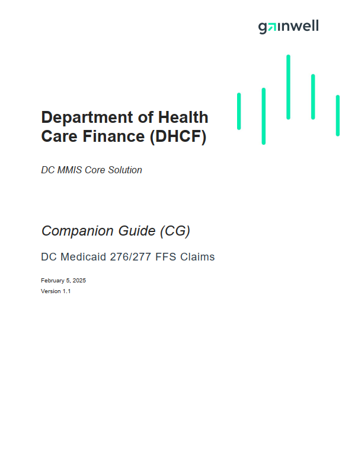

# DC DHCF Companion Guides

**Jordan Yan** – Technical Writer  
Gainwell Technologies technical-writing internship, Summer 2025

---

## Official Public Documents

These EDI Companion Guides to the HIPAA-adopted ASC X12N v5010 TR3s were written at Gainwell Technologies for DC Medicaid (DHCF) trading partners and are **published by Gainwell on gainwelltechnologies.com**. The PDFs in this repo are byte-identical to the published copies (SHA-256 in [Verification](#verification)).

| Guide | Version | Pages | PDF in this repo | Official copy (Gainwell) |
|-------|---------|-------|------------------|--------------------------|
| **837I Institutional Claims** | v1.3 (Jun 17, 2025) | 21 | [DC_837I-FFS-Claims-Companion-Guide-v1.3.pdf](DC_837I-FFS-Claims-Companion-Guide-v1.3.pdf) | [gainwelltechnologies.com](https://www.gainwelltechnologies.com/wp-content/uploads/2025/07/DC_837I-FFS-Claims-Companion-Guide-v1.3.pdf) |
| **276/277 Claim Status** | v1.1 (Feb 5, 2025) | 30 | [DC_276_277FFS-FFS-Claims-Companion-Guide-v1.1.pdf](DC_276_277FFS-FFS-Claims-Companion-Guide-v1.1.pdf) | [gainwelltechnologies.com](https://www.gainwelltechnologies.com/wp-content/uploads/2025/07/DC_276_277FFS-FFS-Claims-Companion-Guide-v1.1.pdf) |

Gainwell has since published a later 837I revision ([v1.5, Sep 2, 2025](https://www.gainwelltechnologies.com/wp-content/uploads/2025/11/DC_837I-FFS-Claims-Companion-Guide-v1.5.pdf)).

---

## My Role

I was a technical-writing intern at Gainwell Technologies in Summer 2025 and worked with these two guides there. The published PDFs credit each revision to Gainwell staff (see [Authorship](#authorship)), so this repo does not claim authorship of either document. What it adds is mine and is in the commit history:

- A Markdown reformat of the 276/277 v1.1 guide: segment tables, acknowledgement and claim-status code tables, and a Mermaid flow diagram ([276-277-enhanced.md](276-277-enhanced.md))
- Byte-identical copies of the published PDFs with SHA-256 hashes ([Verification](#verification))
- Both guides are companions to the ASC X12N v5010 TR3s (837I: 005010X223A2; 276/277: 005010X212)

---

## Authorship

Each PDF's Change History log (page i of the PDF, `pdftotext -layout <file> -` to reproduce) credits its revisions as follows. Neither log names me; the author metadata (`pdfinfo`) is "DuBois, Mary Claire" (837I) and "Bader, Savanna" (276/277).

**837I v1.3**

| Version | Date | Author | Description |
|---------|------|--------|-------------|
| 1.0 | 10/3/2024 | Gainwell Technologies | Initial document creation |
| 1.1 | 2/5/2025 | Sheehan, James | Gainwell Technical Writer Review |
| 1.2 | 6/11/2025 | EDI SWS Team | Applied minor updates: ISA13 unique value required; Billing Provider PRV segment added; 2400 LX segment added |
| 1.3 | 6/17/2025 | Jessica DiBartolo | Gainwell Technical Writer Review |

**276/277 v1.1**

| Version | Date | Author | Description |
|---------|------|--------|-------------|
| 1.0 | 01/30/2025 | Gainwell | Initial Document |
| 1.1 | 02/05/2025 | Savanna Bader | Gainwell Tech Writer Review |

---

## Enhanced 276/277 Guide

I reformatted dense PDF sections into clean, scannable content, with every value cited to a page of the guide or to the X12 code lists:

[View Legible 276/277 Guide →](276-277-enhanced.md)

---

## Screenshots

| 837I Title | 837I Intro | 276/277 Title |
|-----------|------------|---------------|
|  |  |  |

---

## Verification

SHA-256 of the PDFs in this repo, which match the Gainwell-hosted copies linked above (checked 2026-10-23):

| File | SHA-256 |
|------|---------|
| DC_837I-FFS-Claims-Companion-Guide-v1.3.pdf | `86c7faf0ce781ba86936a577afbff08ec90654781e6d35e7d4207a56fa6151f6` |
| DC_276_277FFS-FFS-Claims-Companion-Guide-v1.1.pdf | `56b4b772004f8c761f86dbc7658aa01138bb3e699f6dc94bc84de8b6433ee6ce` |

---

*Source PDFs are published by Gainwell Technologies on gainwelltechnologies.com (links above).*
